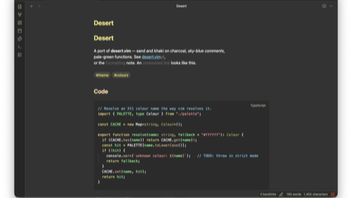
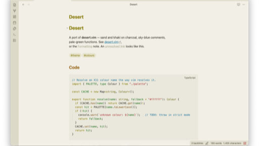

# Desert Theme

A port of Hans Fugal's [desert.vim](https://github.com/fugalh/desert.vim) to
Obsidian — warm sand and khaki on soft charcoal, sky-blue comments, pale-green
functions, olive selections. Supports both dark and light mode.




## Install

**From Obsidian** — Settings → Appearance → Themes → **Manage** → browse for
*Desert*, then select it. This is the normal route once the theme is in the
community directory.

**From a release** — download `manifest.json` and `theme.css` from the
[latest release](../../releases/latest) into a folder named `Desert` inside
your vault:

```
<vault>/.obsidian/themes/Desert/
    manifest.json
    theme.css
```

Then pick it under Settings → Appearance → Themes. The folder name must match
the `name` in `manifest.json` exactly.

**While developing** — copy the two files into that same folder. Obsidian
watches `theme.css` and reloads on change, so edits show up without a restart.

## Layout

`manifest.json` and `theme.css` sit at the repository root, which is where
Obsidian's community directory and the release workflow expect them.

```
manifest.json                  name, version, minAppVersion, author
versions.json                  theme version -> minimum Obsidian version
theme.css                      the whole theme
LICENSE                        MIT, plus attribution for the vim original
package.json                   lint + version scripts, stylelint dev deps
version-bump.mjs               writes manifest.json and versions.json
screenshots/dark.png           512x288 listing image
screenshots/light.png          512x288 listing image
screenshots/demo.md            the note both are captured from
.stylelintrc.json              extends stylelint-config-obsidianmd
.editorconfig                  tabs, LF, UTF-8
.github/workflows/lint.yml     stylelint on push and PR
.github/workflows/release.yml  tag -> draft GitHub release
.github/dependabot.yml         daily npm + actions updates
```

This mirrors the layout of
[obsidian-sample-theme](https://github.com/obsidianmd/obsidian-sample-theme).

## Dark and light

**Dark is desert.vim, transcribed.** Backgrounds, syntax colours and
selections are the vim values, with X11 names resolved exactly as vim resolves
them (`khaki` → `#f0e68c`, `grey20` → `#333333`).

**Light is derived, not transcribed.** desert.vim is `set background=dark` and
has no light counterpart — every colour in it is a light tint chosen to sit on
charcoal, and khaki on white is unreadable. Each light hue here is its dark
sibling pulled to roughly 30–40% lightness, holding hue and role constant:
comments stay sky blue, keywords stay khaki, functions stay green. The page
background is desert's sand `#c2bfa5` lightened to parchment, so light mode
still reads as desert rather than as a generic light theme.

## Code colours

The `--code-*` variables follow desert.vim's highlight groups:

| Role | Dark | Light | vim group |
| --- | --- | --- | --- |
| comment | `#87ceeb` | `#1c7099` | `Comment` (SkyBlue) |
| string, number, boolean | `#ffa0a0` | `#a63030` | `Constant` |
| keyword, operator, tag | `#f0e68c` | `#8a7d0f` | `Statement` (khaki) |
| function | `#98fb98` | `#22701f` | `Identifier` (palegreen) |
| class, type, attr-name | `#bdb76b` | `#6f6a1e` | `Type` (darkkhaki) |
| escape, regex, entity | `#ffdead` | `#9a6a1b` | `Special` (navajowhite) |
| directive, at-rule | `#cd5c5c` | `#93372c` | `PreProc` (indianred) |
| punctuation, plain variables | `#ffffff` | `#2b2a22` | `Normal` |
| property, field | `#d2b48c` | `#8a6230` | `tan` |

Each role is a `--desert-*` variable defined once per colour scheme, so the
token rules at the bottom of `theme.css` are written once and work in both.

Reading view runs Prism and the editor runs CodeMirror, and they use different
class names for the same tokens. Both are styled, so a code block looks
identical either way — if you add a token rule, add it to both lists or the
two views will drift.

Plain variables stay uncolored on purpose. `Identifier` is pale green in vim,
but vim's syntax files apply it almost only to function names — colouring
every variable would look nothing like desert.

## Chrome

Two accents:

- **Sand** (desert.vim's `StatusLine`) — buttons, toggles, focus rings, active
  states, blockquote borders.
- **Sky blue** — links, internal and external. Unresolved links go grey.

Headings run a warm gradient, brightest first: khaki → navajowhite → tan →
sand → darkkhaki → dimmed sand.

## Tweaking

Everything is a variable in the `.theme-dark` and `.theme-light` blocks at the
top of `theme.css`. Copy the file into your vault's theme folder to see
changes; Obsidian reloads it automatically.

- **Syntax colours** — change a `--desert-*` role once and every token using
  it follows, in both reading and editing view.
- **Bold and italic** are left uncoloured; weight and slant do the work. Set
  `--bold-color` / `--italic-color` if you'd rather they were tinted.
- **Heading gradient** — `--h1-color` … `--h6-color`.

## Screenshots

The listing image is **512 x 288**. `screenshots/demo.md` is the note used to
produce it — one screen that exercises every element the theme colours:
headings h1-h6, a TypeScript block hitting all ten syntax roles, inline code, a
callout, blockquote, table, checkboxes, tags, internal/external/unresolved
links, highlight, strikethrough and a footnote.

To retake them:

1. Open Obsidian's **sandbox vault** — Help -> *Open sandbox vault*. It's
   disposable, so nothing here touches a real vault. On macOS it lives at
   `~/Library/Application Support/obsidian/Obsidian Sandbox`.
2. Copy the theme and the demo note into it:

   ```sh
   SB="$HOME/Library/Application Support/obsidian/Obsidian Sandbox"
   mkdir -p "$SB/.obsidian/themes/Desert"
   cp manifest.json theme.css "$SB/.obsidian/themes/Desert/"
   cp screenshots/demo.md "$SB/Desert.md"
   ```

3. Settings -> Appearance: set **Themes** to *Desert*, and turn **Show inline
   title** off so the filename and the `# Desert` heading don't both appear.
4. Open `Desert.md`, hide both sidebars with `Cmd+\`, and wait for the
   "This is a sandbox vault" notice to fade — it will show up in the capture
   otherwise.
5. Capture the window: `Cmd+Shift+4`, then `Space`, then click it.
6. Switch **Base color scheme** to Light and capture again, without moving the
   window.

Then crop to size. A window capture is always taller than 16:9, so resample to
width and centre-crop the height:

```sh
sips --resampleWidth 512 ~/Desktop/dark.png --out screenshots/dark.png
sips -c 288 512 screenshots/dark.png
```

`sips -c` takes height before width, and crops from the centre. Don't use
`sips -Z` — it fits the image *inside* the box rather than covering it, so a
window that isn't already 16:9 comes out the wrong size.

Capture large and downscale, never the reverse; downscaling is what keeps the
text crisp at 512 wide.

## Linting

```sh
npm install     # once
npm run lint    # stylelint, using Obsidian's own config
```

`.github/workflows/lint.yml` runs the same check on every push and pull
request across Node 22, 24 and 26. It uses `npm ci`, so `package-lock.json`
is committed and must stay in step with `package.json`.

`stylelint-config-obsidianmd` is opinionated about notation — short hex,
modern `rgb()` syntax, percentage alpha, no blank line before a custom
property. `npm run lint -- --fix` handles all of it.

## Versioning and release

Bump with npm rather than by hand:

```sh
npm version patch      # or minor / major
```

That runs `version-bump.mjs` through npm's `version` hook, which writes the
new version into `manifest.json`, appends a `{version: minAppVersion}` entry
to `versions.json`, and stages both.

`versions.json` is a compatibility history — `manifest.json` records
`minAppVersion` only for the current release, while `versions.json` records it
for every release, so someone on an older Obsidian can be served the newest
version they can actually run instead of one that requires a newer app.

Then tag and push:

```sh
git push && git push --tags
```

`.github/workflows/release.yml` picks up the tag and creates a **draft**
release with `manifest.json` and `theme.css` attached.

**Publish the draft.** A draft is not visible outside the repository, so
Obsidian cannot see it — the community tool reports *"No release matches your
manifest version"* until it is published.

```sh
gh release edit 1.0.1 --draft=false
```

Three things have to line up or the directory will not find the release:

| Requirement | Why |
| --- | --- |
| Tag has **no `v` prefix** | Obsidian matches `manifest.json`'s `version` string exactly. `.npmrc` sets `tag-version-prefix=""` so `npm version` produces `1.0.1`, not npm's default `v1.0.1`. |
| Release is **published**, not draft | Drafts are private to the repo. |
| Workflow has `permissions: contents: write` | Repositories default to read-only tokens; without it `gh release create` fails with `HTTP 403: Resource not accessible by integration`. |

The workflow checks the first of these itself and fails the job with a clear
message rather than creating a mismatched release. Publish the draft when you're happy with the notes.

## Credit

Original colour scheme by Hans Fugal <hans@fugal.net>, distributed with vim.
Light mode and all Obsidian-specific colours are adaptations; see the notes in
`theme.css` for which is which.
